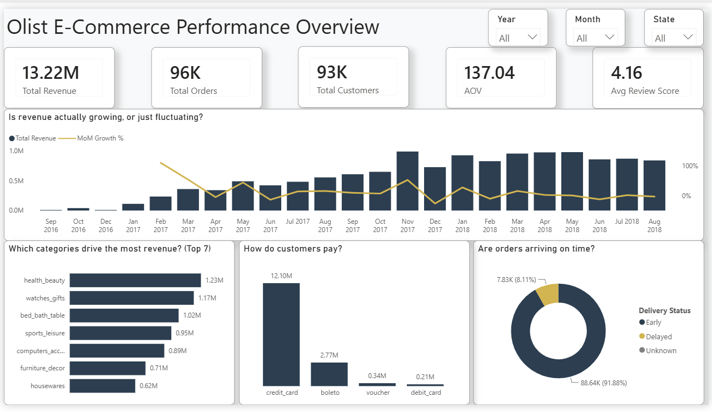
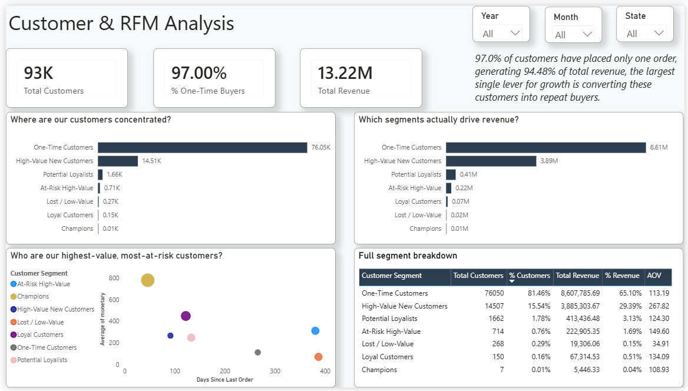
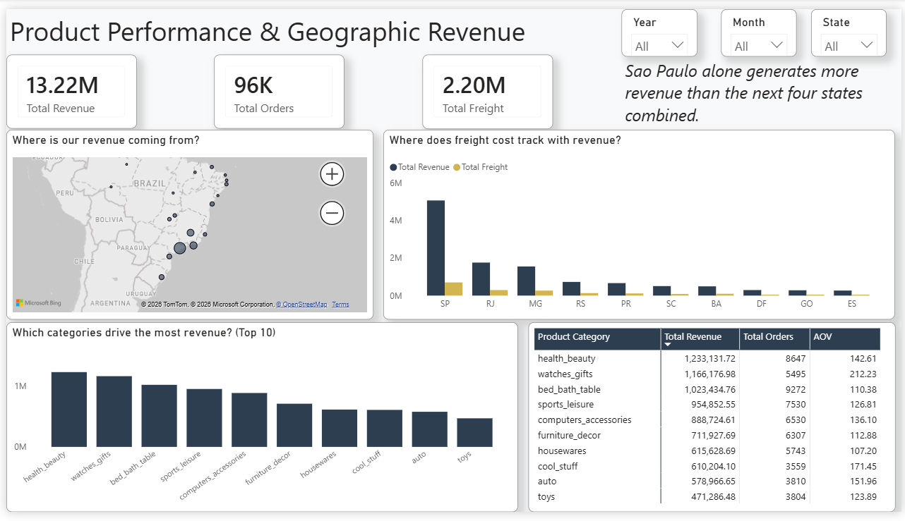
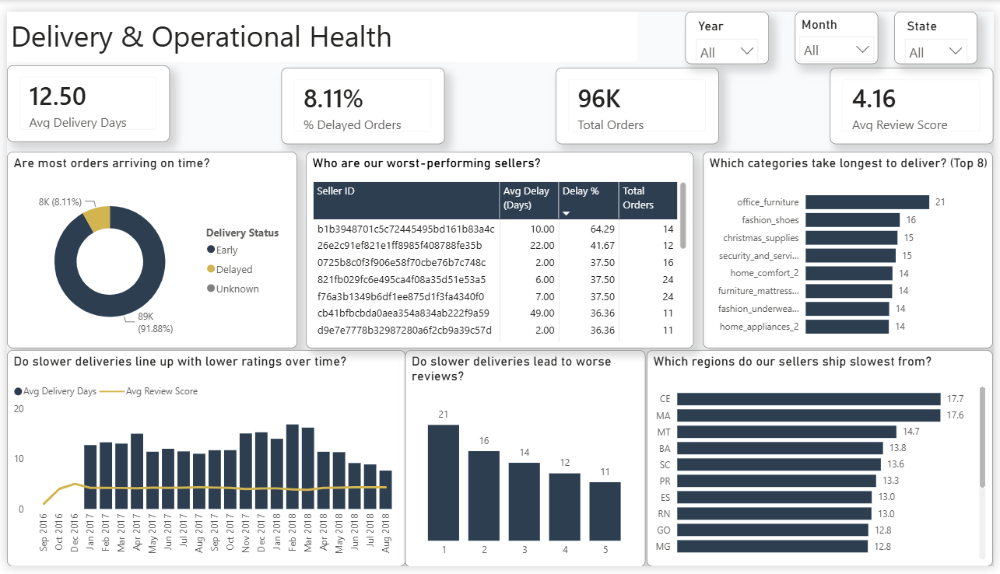

# Olist E-Commerce Analytics

An end-to-end analytics project on the [Brazilian E-Commerce Public Dataset by Olist](https://www.kaggle.com/datasets/olistbr/brazilian-ecommerce) — 9 relational tables covering ~100K orders from a Brazilian marketplace between 2016 and 2018. The pipeline runs Python/Pandas → SQL Server → Power BI, and answers sales, customer, delivery, and seller-performance questions along the way.


---

## Tech stack

`Python (Pandas)` · `SQL Server (T-SQL)` · `sqlalchemy` / `pyodbc` · `Power BI` · `DAX`

---

## Repo structure

```
olist-ecommerce-analytics/
├── data/
│   ├── raw/                  # place downloaded Kaggle CSVs here (not committed)
│   └── cleaned/               # generated by 02_cleaning.ipynb (not committed)
├── 01_data_cleaning/
│   ├── 01_eda.ipynb           # null checks, orphan-key checks, timestamp/duplicate checks
│   ├── 02_cleaning.ipynb      # fillna on products, datetime conversion, CSV export
│   └── 03_load_to_sql.ipynb   # loads cleaned CSVs into SQL Server via to_sql()
├── 02_sql/
│   ├── 00_load_and_validate.sql
│   ├── 01_check_and_convert_datetimes.sql
│   ├── 02a_business_questions_core.sql
│   ├── 02b_business_questions_advanced.sql
│   ├── 03_views.sql
│   └── 04_validate_views.sql
├── 03_powerbi/
│   ├── dashboard.pbix
│   └── dax_measures.md
└── docs/
    └── screenshots/
```

---

## Reproducing this project

**1. Get the data**
Download the dataset from Kaggle: **https://www.kaggle.com/datasets/olistbr/brazilian-ecommerce**
Unzip and place all 9 CSVs into `data/raw/`.

**2. Run the cleaning pipeline**
Open and run, in order, from inside `01_data_cleaning/`:
- `01_eda.ipynb`
- `02_cleaning.ipynb` — writes cleaned CSVs to `data/cleaned/`
- `03_load_to_sql.ipynb` — loads all 9 cleaned tables into a SQL Server database (adjust the connection string's server/database name for your environment)

**3. Run the SQL scripts**
In SQL Server Management Studio, run the files in `02_sql/` in numeric order (`00` → `01` → `02a` → `02b` → `03` → `04`). Files `02a` and `02b` are independent of each other and can be run in either order relative to one another, but both expect `00` and `01` to have already run, and `03`/`04` (views + view validation) expect the base tables from step 2 to exist.

**4. Open the dashboard**
Open `03_powerbi/dashboard.pbix` in Power BI Desktop and point the data source at your SQL Server instance.

---

## The data model

Four fact tables and three dimension tables, built as SQL views on top of the cleaned base tables:

| View | Grain |
|---|---|
| `vw_fact_order_items` | one row per line item on a delivered order |
| `vw_fact_orders` | one row per delivered order, with the most recent review score attached |
| `vw_fact_payments` | one row per payment transaction on a delivered order |
| `vw_rfm_segments` | one row per customer, with Recency/Frequency/Monetary scores and segment |
| `vw_seller_delivery_performance` | one row per seller, with delivery timing stats |
| `vw_dim_customer` | one row per customer, keyed on `customer_unique_id` |
| `vw_dim_product` | one row per product, with English category name |
| `vw_dim_seller` | one row per seller |

Fact tables relate only to dimension tables, never directly to each other — bridging between two fact tables (e.g. attaching delivery timing to a category-level chart) is done in DAX with `TREATAS`, not by adding a direct relationship. `vw_rfm_segments ↔ vw_dim_customer` and `vw_seller_delivery_performance ↔ vw_dim_seller` are the two exceptions where a bidirectional 1:1 relationship is used — this isn't a default left unexamined, it's structurally required, since both dimension tables are shared across multiple fact tables and Power BI does not offer single-direction filtering as a valid option on these two relationships specifically.

Revenue is defined consistently throughout as `SUM(price)` from order items, filtered to `order_status = 'delivered'`, dated by `order_purchase_timestamp`.

---

## Dashboard

Four pages, each with Year / Month / State slicers:

**Overview** — headline KPIs, month-over-month revenue trend, top categories by revenue, payment method split, on-time delivery rate.


**Customer & RFM** — RFM segmentation, revenue concentration by segment, full segment breakdown table.


**Product & Geography** — revenue by state (map), category revenue ranking, freight vs revenue by state.


**Delivery & Operations** — on-time rate, worst-performing sellers, slowest categories/regions to deliver, delivery-vs-review-score trend.


---

## Key findings

- **97.0% of customers have placed only one order**, and they account for **94.48% of total revenue** — this is the single most important characteristic of the marketplace's customer base, and the largest growth lever by far is converting one-time buyers into repeat customers. (81.46% of customers sit in the RFM "One-Time Customers" segment specifically — the remainder of the 97.0% are one-time buyers whose first order was high-value enough to be tracked separately as "High-Value New Customers.")
- **High-Value New Customers** (recent, high-spend, first-time buyers) are only 15.54% of the customer base but drive 29.39% of revenue.
- **714 At-Risk High-Value customers** — previously strong spenders who haven't ordered recently — represent a concentrated retention opportunity.
- **São Paulo alone generates more revenue than the next four states combined.**
- **8.11% of delivered orders arrive later than the estimated delivery date**, with an average delay of 12.50 days across all orders.
- State- and seller-level delivery metrics require a minimum order-count threshold to be meaningful: one seller in Amazonas (AM) state with only 3 delivered orders and one bad delivery produces a 48-day "average" delay for the entire state if no threshold is applied. Dashboard state-level delivery visuals are filtered to states with ≥15 delivered orders for this reason.

---

## Lessons learned

A few honest notes on things that went wrong during this project and how they were caught and fixed — kept here deliberately rather than hidden, since finding and fixing this kind of issue is a normal part of the actual work.

- **CSV round-trips lose dtype information.** Converting date columns to `datetime` in Pandas doesn't survive `.to_csv()` / `.read_csv()` — SQL Server received these columns as plain text regardless of what dtype they were in Pandas, so the real datetime typing had to happen in SQL (`01_check_and_convert_datetimes.sql`), not in the cleaning notebook.
- **An early Pandas bug created a duplicate, misspelled column** (assigning the output of `pd.to_datetime(...)` to a new, misspelled column name instead of overwriting the original column in place). This required a SQL Server rename/drop workaround at the time; the workaround is no longer needed since the notebook now converts the column in place, and the workaround files were removed rather than left as dead weight.
- **A handful of `product_category_name` values don't exist in the category translation table** (e.g. `pc_gamer`, near-duplicates of categories that do exist under a slightly different name). This surfaces as a small, known gap wherever the model inner-joins to the translation table, and is called out explicitly rather than silently absorbed.
- **Two prototype views (`vw_category_revenue`, `vw_monthly_revenue`, `vw_state_revenue`) were built during initial modeling and later replaced** by direct DAX measures once the dashboard's real requirements became clearer. They were dropped from the final SQL rather than left in the repo unused.
- **RFM thresholds are quintile-derived**, not arbitrary round numbers — recency, frequency, and monetary boundaries were calculated from the actual distribution of delivered-order customers, not picked by inspection.

## Power BI Dashboard

The project includes an interactive Power BI dashboard
for analysing e-commerce performance.

[Download Power BI Dashboard (.pbix)](https://github.com/Adityastarfield/olist-ecommerce-analytics/releases/tag/v1.0)
